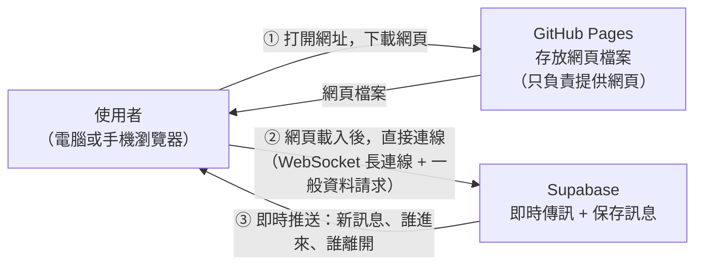
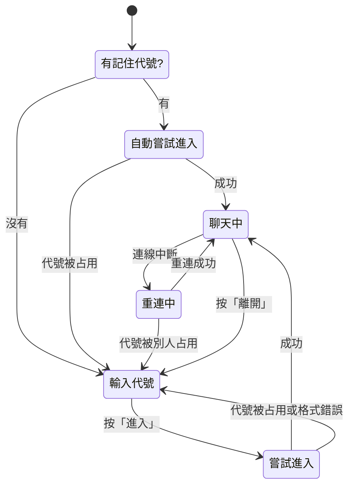

# 匿名聊天室：架構文件

> 這份文件寫給「不寫程式的人」看。專有名詞第一次出現時，會用一句話解釋。
> 文件裡沒有任何程式，只描述「要做什麼、為什麼這樣做」。

---

## 1. 專案說明與目標

### 這是什麼
一個不用註冊、不用登入的匿名聊天室。所有人都在同一個聊天室裡，只要知道網站連結，用電腦或手機都能進來聊天。

### 使用者會做的事
1. 打開網頁。
2. 輸入一個「代號」（相當於暱稱）。
3. 進入聊天室，看到最近的對話，也可以送出自己的訊息。
4. 隨時看得到誰在線上；有人進來或離開時會有提示。
5. 想離開時按「離開」。

### 已經決定的規則（訪談結論）

| 項目 | 規則 |
|---|---|
| 代號 | 1 到 12 個字，任何字元都可以（含 emoji），不能全是空白。英文大小寫視為相同（Tom 和 tom 是同一個）|
| 代號重複 | 如果有人正在線上使用，別人就不能用。對方離開後，代號就能再被使用 |
| 記住代號 | 瀏覽器會記住上次的代號，下次打開自動帶入並直接進入聊天室 |
| 訊息 | 只能傳純文字，最多 500 字，不能傳空白訊息 |
| 送出方式 | 電腦：Enter 送出、Shift+Enter 換行。手機：按送出按鈕 |
| 歷史紀錄 | 所有訊息都會保存。新人進來時，畫面先顯示最近 50 則（只有聊天訊息，沒有進出提示）|
| 在線名單 | 電腦版：右側固定一欄。手機版：頂部顯示「N 人在線」，點一下展開 |
| 進出提示 | 聊天中插入灰色小字，例如「小明 進入了聊天室」。只在你在線的期間即時出現，不存進歷史。斷線或關掉分頁也算離開 |
| 斷線 | 顯示「重新連線中」，自動重連，補上漏掉的訊息。如果代號在斷線期間被別人占用，回到輸入代號的畫面並說明原因 |
| 離開 | 有「離開」按鈕，按下後清掉記住的代號。沒有「改名」功能，要換代號就離開再進來 |
| 防洗版 | 同一個代號，每 2 秒最多送 1 則訊息 |
| 背景提醒 | 分頁在背景時，標題顯示未讀數，例如「(3) 匿名聊天室」|

### 目標
- 第一步：先做出完整、好用的畫面，放到 GitHub Pages 上，任何人都看得到。
- 第二步：再接上 Supabase，讓不同的人真的能即時互相聊天。
- 整個過程中，第二步不能讓第一步的成果重做。

---

## 2. 整體架構圖

先認識三個角色：

- **瀏覽器**：使用者用來看網頁的軟體（Chrome、Safari 等）。聊天室的畫面和操作邏輯都在這裡執行。
- **GitHub Pages**：GitHub 提供的免費網頁空間。它只負責「把網頁檔案交給瀏覽器」，自己不會做任何運算，也不會儲存聊天內容。
- **Supabase**：一個現成的線上後端服務（後端就是「在遠端幫你存資料、轉發訊息的那一端」）。聊天訊息的保存和即時傳遞都靠它。



這張圖要記住兩件事：

1. **GitHub Pages 和 Supabase 之間沒有任何關係。** 網頁載入完成後，是「你的瀏覽器」直接去找 Supabase。
2. **聊天內容完全不會經過 GitHub Pages。** GitHub Pages 只是個放檔案的地方。

> **WebSocket**：一種「一直保持連著」的網路連線方式。一般網頁是「問一次、答一次」，WebSocket 則像打電話，接通後雙方隨時可以講話，所以適合即時聊天。

---

## 3. 技術選擇

### 3.1 前端（使用者看到和操作的部分）

> **前端**：在使用者瀏覽器裡執行的那部分程式，負責畫面和操作。
> **框架**：一套現成的程式骨架，幫你處理「資料變了，畫面要跟著更新」這類重複的工作。

| 項目 | 選了什麼 | 為什麼 |
|---|---|---|
| 程式語言 | **TypeScript** | 它是 JavaScript（網頁唯一通用的語言）加上「資料格式檢查」。例如規定「訊息一定有代號、內容、時間」，寫錯欄位名稱時，在寫程式的當下就會被抓出來，不用等使用者遇到問題才發現 |
| 框架 | **Preact** | 聊天室有好幾個會互相影響的狀態（連線中、訊息列表、在線名單、輸入代號或聊天中），用框架管理比手寫更不容易出錯。Preact 是輕量版（約 3KB），手機載入快。它和最常見的 React 用法幾乎相同，之後 `/frontend-design` 做出來的畫面元件也能直接使用 |
| 建置工具 | **Vite** | 負責把我們寫的程式「打包」成瀏覽器能直接用的一般網頁檔案。打包出來的是純靜態檔案，正好是 GitHub Pages 唯一能放的東西 |

**沒有選的：**
- Next.js 等需要伺服器的框架：GitHub Pages 不能執行伺服器程式，用不了。
- 完全不用框架：這個專案雖小，但狀態很多，手寫容易出現「畫面和資料對不起來」的錯誤。

### 3.2 Supabase 要用哪些功能

> **Postgres**：一種資料庫，也就是「把資料整齊存起來的軟體」。Supabase 底下用的就是它。
> **資料表**：資料庫裡像 Excel 工作表的東西，一列是一筆資料。

Supabase 提供好幾種功能，這個專案用到其中三個：

| 要解決的需求 | 選了什麼 | 為什麼 |
|---|---|---|
| 誰在線上、誰進來、誰離開 | **Realtime Presence**（即時在線狀態）| 這個功能就是為「在線名單」設計的。使用者關掉分頁或斷網時，Supabase 會自動發現並通知大家，我們不用自己做「定時確認你還在不在」的機制 |
| 保存聊天訊息、讓新人看到最近 50 則 | **Postgres 資料表**（一張叫 `messages` 的表）| 要讓新人看到歷史訊息，訊息就必須被保存下來。資料表正好做這件事 |
| 有人送出新訊息時，立刻讓所有人看到 | **Realtime 的資料表變動推送**（訂閱 `messages` 表的新增）| 訊息寫入資料表的那一刻，Supabase 就自動推給所有人。順序和內容都以資料庫為準，所以不會出現「我看到的和你看到的不一樣」|

**沒有選的：**
- **Realtime Broadcast**（廣播，不經過資料庫直接轉發）：速度很快，但訊息不會被保存，我們還得另外存一份。兩邊容易不一致，所以不用。
- **Supabase Auth**（登入系統）：需求明確說不要登入。

### 3.3 保護資料的機制（設在 Supabase 這一端）

因為沒有自己的伺服器，網頁是直接連 Supabase，所以「誰能做什麼」必須由 Supabase 自己把關：

> **RLS（資料列安全規則）**：資料庫層級的權限規則，例如「所有人只能讀和新增，不能改、不能刪」。
> **Trigger（觸發器）**：一條掛在資料表上的自動規則，每次有新資料要寫入時，自動先檢查一次，不合格就拒絕。

- 用 RLS 規定：任何人只能「讀取」和「新增」訊息，**不能修改、不能刪除**。
- 用資料表的欄位限制規定：代號 1 到 12 字、內容 1 到 500 字。
- 用 trigger 做防洗版：同一個代號 2 秒內已經送過訊息，就拒絕。

---

## 4. 兩個階段

### 4.1 階段一：還沒接 Supabase

#### 前端可以做到什麼程度
**所有畫面和操作都能完整做出來並實際操作**，唯一做不到的是「不同人之間真的互相看到」。

階段一會有一個「假的後端」，我們叫它**模擬服務**，它在瀏覽器裡假裝成聊天室的另一端：

- 輸入代號時，會檢查格式，也會檢查是否重複。
- 進入聊天室後，有幾則事先準備好的歷史訊息。
- 送出訊息後，自己的訊息會出現在畫面上。
- 會有幾個「假用戶」偶爾自動講話、進來、離開，讓你能看到進出提示、在線名單變化、「有新訊息」按鈕等效果。
- 有一個隱藏的測試開關，可以手動模擬「斷線」和「代號被占用」，用來檢查這兩個畫面。
- **同一台電腦、同一個瀏覽器**開兩個分頁，這兩個分頁可以互相聊天，因為模擬服務會用瀏覽器內建的分頁通訊功能彼此傳話。這個方式可以拿來測試「兩個人」的情況。

**限制：** 不同裝置之間（例如你的電腦和你的手機）互相看不到對方。這是階段一刻意接受的限制，要靠階段二才能解決。

#### 怎麼在 GitHub Pages 上看到
階段一做出來的版本，會和階段二一樣被打包並部署到 GitHub Pages（做法見第 12 節）。你和任何人只要打開那個網址，就能看到並操作這個「有模擬後端」的版本，也可以在手機上打開，檢查手機版版面。

### 4.2 階段二：接上 Supabase 之後的改變

| | 階段一 | 階段二 |
|---|---|---|
| 訊息從哪裡來 | 模擬服務（瀏覽器內部）| Supabase |
| 歷史訊息 | 事先準備的假資料 | 資料庫裡真實保存的紀錄 |
| 在線名單 | 假用戶 + 同瀏覽器的其他分頁 | 世界上所有真的在線的人 |
| 不同裝置互通 | 不行 | 可以 |
| 防洗版、長度限制 | 只有前端檢查 | 前端檢查 + Supabase 端強制檢查 |
| 需要金鑰 | 不需要 | 需要（見第 8 節）|

**畫面本身一個字都不用改。** 改變的只有「資料來源」。

### 4.3 前端怎麼設計，才不用重寫

做法：**在畫面和資料來源之間，訂一份「合約」（稱為服務介面）。**

可以想成家裡的插座：
- 畫面是電器，它只知道「我需要插座提供電」，不在乎牆後面接的是發電廠還是發電機。
- 「服務介面」就是插座的規格。
- 階段一，插座後面接的是「模擬服務」；階段二，換成接「Supabase 服務」。電器（畫面）完全不用換。

具體來說：

1. 先訂好「服務介面」要提供的動作（進入、送訊息、離開）和會發出的通知（收到歷史、收到新訊息、在線名單改變、有人進來或離開、連線狀態改變）。這份約定寫在第 5 節。
2. 所有畫面只透過這份約定跟資料來源溝通，**畫面程式碼裡完全不出現 Supabase 這個詞**。
3. 階段一做「模擬服務」，嚴格遵守同一份約定。
4. 階段二做「Supabase 服務」，同樣遵守這份約定。
5. 用一個設定開關決定用哪一個。開關改了，整個網站就換了資料來源。

這樣做有一個額外的好處：階段二如果出問題，改一個開關就能退回階段一，網站不會壞掉。

---

## 5. 通訊約定

這一節定義「畫面」和「資料來源」之間說什麼話。階段一的模擬服務和階段二的 Supabase 服務，都必須照這份約定做。

### 5.1 畫面對資料來源下的指令

| 指令名稱 | 什麼時候用 | 帶什麼資料 | 可能的結果 |
|---|---|---|---|
| `join`（進入）| 按下「進入」，或打開網頁自動帶入代號時 | 代號 | 成功；或失敗：代號已被使用、代號格式不合 |
| `send`（送出）| 按下送出 | 訊息內容 | 成功；或失敗：送太快、內容不合格、目前離線 |
| `leave`（離開）| 按下「離開」| 無 | 一律成功 |

### 5.2 資料來源通知畫面的事件

| 事件名稱 | 什麼時候發生 | 帶什麼資料 |
|---|---|---|
| `history_loaded` | 剛進入聊天室、或重連後補資料 | 一串訊息（最近 50 則，或漏掉的那些）|
| `message_received` | 有人送出新訊息（包含自己的）| 一則訊息 |
| `presence_updated` | 在線名單有變動 | 目前所有在線代號的清單 |
| `user_joined` | 有人進入聊天室 | 代號 |
| `user_left` | 有人離開（含斷線、關閉分頁）| 代號 |
| `connection_changed` | 連線狀態改變 | 狀態：`connected`（已連線）、`reconnecting`（重連中）、`nickname_lost`（斷線期間代號被別人占用）|

### 5.3 資料格式

**一則訊息：**

| 欄位 | 意義 | 規則 |
|---|---|---|
| `id` | 訊息編號 | 由資料庫產生，一直遞增，用來避免同一則訊息顯示兩次 |
| `nickname` | 發送者代號 | 1 到 12 字 |
| `content` | 訊息內容 | 1 到 500 字，純文字 |
| `created_at` | 送出時間 | 由資料庫記錄，不信任使用者裝置的時間（裝置時間可能不準）|

**一個在線的人：**

| 欄位 | 意義 |
|---|---|
| `nickname` | 代號 |
| `online_at` | 進入的時間（遇到兩人同時搶同一個代號時，用來判斷誰先來）|

**一則進出提示（只存在於畫面上，不存檔）：**

| 欄位 | 意義 |
|---|---|
| `type` | `join`（進來）或 `leave`（離開）|
| `nickname` | 代號 |
| `time` | 發生時間（顯示用）|

### 5.4 代號的比對規則
- 前後空白先去掉。
- 全形與半形、大小寫先統一，再比較是否重複。
- 畫面上顯示的是使用者「原本輸入的樣子」，比對時才用統一後的樣子。

---

## 6. 資料流

### 6.1 進入聊天室

1. 使用者打開網頁。
2. 網頁看瀏覽器有沒有記住上次的代號。
   - **有**：直接帶入並嘗試進入（下一步）。
   - **沒有**：顯示輸入代號的畫面，等使用者輸入。
3. 檢查代號格式（1 到 12 字、不是全空白）。不合格就在輸入框下方提示原因。
4. 發出 `join`，資料來源檢查這個代號是否已有人在線上。
   - **已被占用**：回到輸入畫面，提示「這個代號已被使用」。
   - **可用**：登記為在線，載入最近 50 則歷史訊息（`history_loaded`），記住這個代號，進入聊天畫面。
5. 其他人會收到 `user_joined`，聊天中出現「某某 進入了聊天室」。

### 6.2 送出訊息

1. 使用者輸入並按送出（電腦：Enter）。
2. 網頁先做檢查：不是空白、不超過 500 字、離上次送出超過 2 秒。不合格就提示，不送出。
3. 發出 `send`。階段二時，Supabase 端會再做一次同樣的檢查，因為前端的檢查可以被繞過，Supabase 端的才是最終把關。
4. 訊息被存下後，所有人（包括自己）都收到 `message_received`。
5. 畫面上顯示這則訊息：自己的靠右並有不同顏色，別人的靠左。
6. 捲動行為：
   - 如果你本來就在最底下：自動捲到最新。
   - 如果你正在往上看舊訊息：不拉你，而是出現「有新訊息」按鈕，點了才跳到底。
7. 如果分頁在背景：標題的未讀數加一，回到分頁時清零。

### 6.3 離開

**主動離開（按「離開」）：**
1. 發出 `leave`，從在線名單移除。
2. 清掉瀏覽器記住的代號。
3. 回到輸入代號的畫面。
4. 其他人收到 `user_left`，看到「某某 離開了聊天室」。

**被動離開（關掉分頁、手機鎖屏太久、網路斷了）：**
1. 資料來源（Supabase）自己偵測到這個人的連線消失。
2. 其他人收到 `user_left`，看到離開提示。
3. 這種情況**不會**清掉瀏覽器記住的代號，所以他之後打開網頁，會自動以同一個代號進入。

### 6.4 斷線重連

1. 網路中斷或手機切到背景，連線掉了。
2. 收到 `connection_changed`（`reconnecting`）。畫面頂部出現「連線中斷，重新連線中…」，送出按鈕暫時停用，但已經看到的訊息保持顯示。
3. 系統自動重試連線，使用者不用手動重新整理。
4. 手機從背景回到前景時，也會主動檢查連線，因為手機系統常常在背景時悄悄中斷連線。
5. 連回來之後：
   - 嘗試以原本的代號重新登記在線。
   - **成功**：向資料庫要「斷線之後新出現的訊息」，補在畫面上（用訊息編號判斷，避免重複）。頂部提示消失，送出功能恢復。
   - **失敗，因為代號已被別人用了**：收到 `connection_changed`（`nickname_lost`），回到輸入代號的畫面，並說明「斷線期間，這個代號已被別人使用，請換一個」。

---

## 7. 畫面清單

只描述「有什麼元素、各自的行為」，不規定顏色、字型、樣式（那是 `/design` 的工作）。

整個網站只有**兩個主要畫面**，加上一個**在手機上才有的面板**。

### 7.1 畫面 A：輸入代號

| 元素 | 行為 |
|---|---|
| 網站名稱 / 簡短說明 | 純文字，說明這是匿名聊天室 |
| 代號輸入框 | 最多 12 字。輸入時顯示目前字數。帶入上次記住的代號（如果有，則自動進入，不會停在這個畫面）|
| 「進入」按鈕 | 輸入不合格時不能按。按下後進入「進入中」狀態（按鈕暫停，避免連按）|
| 錯誤提示區 | 顯示原因：代號是空的、超過 12 字、代號已被使用、斷線期間代號被占用、連線失敗 |
| 手機鍵盤 | 輸入框被鍵盤擋住時，畫面要自動調整 |

按 Enter 也能進入。

### 7.2 畫面 B：聊天室

分成幾個區塊：

**(1) 頂部列**

| 元素 | 行為 |
|---|---|
| 網站名稱 | 純顯示 |
| 在線人數（手機版）| 顯示「N 人在線」，點一下展開在線名單面板（見 7.3）。電腦版不顯示，因為名單已固定在右側 |
| 「離開」按鈕 | 按下後離開並回到畫面 A。為避免誤觸，建議按下後要再確認一次 |
| 連線狀態提示列 | 平常不顯示。斷線時顯示「連線中斷，重新連線中…」|

**(2) 訊息區（中間，可上下捲動）**

| 元素 | 行為 |
|---|---|
| 聊天訊息 | 每則顯示：代號、內容、時間（例如 14:32）。自己的靠右、有區別；別人的靠左 |
| 進出提示 | 灰色小字，例如「小明 進入了聊天室」。夾在訊息之間，依發生時間排列 |
| 「有新訊息」按鈕 | 只在你往上翻舊訊息、而這時有新訊息進來時才出現。點一下跳到最底並消失 |
| 空狀態 | 還沒有任何訊息時顯示「還沒有人說話，來打聲招呼吧」|
| 捲動規則 | 離最底部很近（約一個手指寬）就當作「在最底」，新訊息自動捲到底 |

**(3) 在線名單（電腦版右側，固定顯示）**

| 元素 | 行為 |
|---|---|
| 標題 | 「在線 N 人」|
| 名單 | 列出所有在線代號。自己的代號有標示（例如後面加「你」）|
| 即時更新 | 有人進入或離開時，名單立刻更新 |

**(4) 輸入區（底部，固定）**

| 元素 | 行為 |
|---|---|
| 訊息輸入框 | 最多 500 字，接近上限時顯示剩餘字數。電腦：Enter 送出、Shift+Enter 換行 |
| 「送出」按鈕 | 空白時不能按；離線時不能按；手機主要靠它送出 |
| 送太快的提示 | 2 秒內再送時，提示「送太快了，請稍等」，不送出 |

**(5) 分頁標題**

- 分頁在背景時，每收到一則別人的訊息就把未讀數加一，標題變成「(3) 匿名聊天室」；回到分頁時清零。

### 7.3 手機版：在線名單面板

| 元素 | 行為 |
|---|---|
| 開啟方式 | 點頂部「N 人在線」|
| 內容 | 和電腦版右側相同：列出所有在線代號 |
| 關閉方式 | 再點一次，或點面板外面 |

### 7.4 畫面切換整理



---

## 8. 金鑰

> **金鑰**：一串很長的文字，像密碼，用來向 Supabase 證明「我是被允許連線的網站」。

### 8.1 這個專案會碰到的金鑰

| 名稱 | 白話說明 | 可以公開嗎 | 放在哪裡 |
|---|---|---|---|
| **網址（Project URL）** | 你的 Supabase 專案的地址 | 可以。本來就會出現在網頁裡 | 前端設定檔 |
| **anon key**（新版介面可能叫 **publishable key**）| 「一般訪客用」的金鑰。它的權限由前面第 3.3 節的規則決定，只能做規則允許的事 | **可以公開。** 它一定會被打包進網頁，任何人按右鍵「檢視原始碼」都看得到。這是設計如此，不是漏洞 | 前端設定檔 |
| **service_role key**（新版介面可能叫 **secret key**）| 「超級管理員」金鑰，可以無視所有規則，讀寫、刪除一切資料 | **絕對不能公開。** | **這個專案完全不使用它，不放進專案、不放進 GitHub、不放進網頁** |
| **資料庫密碼** | 建立 Supabase 專案時設定的密碼，用來直接連資料庫 | **絕對不能公開。** | 只存在你自己的密碼管理工具；這個專案不需要它 |
| **Supabase 帳號密碼** | 登入 Supabase 網站管理後台用 | **絕對不能公開。** | 你自己保管 |

**最重要的觀念：** 這個專案的安全，不是靠「把 anon key 藏起來」，因為它藏不住。安全靠的是第 3.3 節的規則（RLS、欄位限制、trigger），讓拿到 anon key 的人也只能做我們允許的事。

### 8.2 怎麼產生
1. 到 Supabase 網站註冊並建立新專案（建立時會要你設定一組資料庫密碼，請自己保管，不要貼給任何人）。
2. 專案建好後，到「Project Settings → API」頁面。
3. 這個頁面會顯示 **Project URL** 和 **anon / publishable key**，複製這兩項即可。
4. 同一個頁面也會顯示 service_role / secret key，**不要複製、不要使用**。

### 8.3 放在哪裡

| 情境 | 放哪裡 |
|---|---|
| 在你自己電腦上開發、測試 | 專案根目錄的 `.env.local` 檔案（只存在你的電腦上，不會被上傳）|
| 說明檔 | `.env.example`：只寫欄位名稱和空白範例，讓別人知道需要填哪些項目，不含真實的值 |
| 部署到 GitHub Pages | GitHub 專案的「Settings → Secrets and variables → Actions」。建置時由自動化流程取用並寫進網頁 |

### 8.4 怎麼避免被上傳到 GitHub

1. 在 `.gitignore`（告訴 git「這些檔案不要追蹤」的清單）中，列入 `.env.local` 和其他 `.env` 類檔案。
2. 只 commit `.env.example`，裡面不放任何真實的值。
3. 每次 commit 前檢查：請 Claude 或你自己搜尋有沒有出現 `service_role`、`secret`、`eyJ`（金鑰常見開頭）等字樣出現在要上傳的檔案裡。
4. 開啟 GitHub 的「Secret scanning」（密碼外洩掃描），它會自動偵測並通知你。
5. **萬一不小心 commit 了 service_role key：** 立刻到 Supabase 後台重新產生（作廢舊的），單純刪掉檔案不夠，因為 git 歷史裡還留著。

---

## 9. 安全與限制

### 9.1 別人可能送什麼奇怪的東西進來

> 前端的檢查是「友善提示」，真正的把關在 Supabase 端。因為有人可以繞過我們的網頁，直接對 Supabase 發請求。所以每一項都分成「前端怎麼擋」和「Supabase 端怎麼擋」。

| 可能的情況 | 前端怎麼擋 | Supabase 端怎麼擋 |
|---|---|---|
| 超長訊息（例如貼上一大篇文章）| 輸入框限制 500 字，貼上時截斷並提示 | 資料表欄位限制長度，超過就拒絕 |
| 空白或全是空格的訊息 | 送出鈕不可按 | 欄位限制長度至少 1；內容先去空白再檢查 |
| 網頁程式碼（例如 `<script>…</script>`，想讓其他人的瀏覽器執行惡意程式，這種攻擊叫 XSS）| **所有訊息和代號一律當作「純文字」顯示，絕不當成網頁碼解讀**。這是前端最重要的一道防線 | 不做額外處理（內容原樣保存，由前端負責安全顯示）|
| 瘋狂快速送訊息（洗版）| 2 秒內不能再送，提示「送太快了」| trigger：同一代號 2 秒內已有訊息就拒絕 |
| 很長的代號、全空白的代號 | 限制 1 到 12 字，不接受全空白 | 資料表欄位長度限制 |
| 看起來一樣但其實不同的代號（例如全形與半形、大小寫、用看不見的特殊字元偽裝）| 比對前先統一全形半形和大小寫；移除看不見的控制字元 | 同上，雙重保險 |
| 冒用別人的代號發言 | 無法完全防止 | **這是「不要登入」的代價。** 沒有登入，系統無法確認誰是誰。只能做到「同一時間線上不會有兩個相同代號」，但不能阻止有技術的人直接對 Supabase 發請求，在訊息上填別人的代號。我們接受這個限制 |
| 修改或刪除別人的訊息 | 沒有這類功能 | RLS：不允許修改、不允許刪除 |
| 大量開分頁、用程式假裝很多人上線 | 無法防止 | 靠 Supabase 免費方案的連線上限自然限制；無法完全防止，這一版接受 |
| 不當、冒犯的內容 | 無 | 這一版沒有處理（見第 10 節），事後只能由你到 Supabase 後台手動刪除 |

### 9.2 Supabase 免費方案的上限

以下數字是撰寫時的大致情況，**每個數字在實際動工前都要到 Supabase 官方價格頁面再確認一次**，因為方案內容可能調整。

| 項目 | 大致限制 | 對這個專案的影響 |
|---|---|---|
| 同時連線人數 | 約 200 | 同一時間最多約 200 人在聊天室。夠一般朋友圈或小社群使用 |
| 每月即時訊息數 | 約 200 萬則 | 每一則聊天、每一次有人進出都會計算，並且要乘上「接收的人數」。人多、話多的時候，可能會先用完這個額度 |
| 資料庫容量 | 約 500MB | 純文字很小，一則訊息約不到 1KB，短期內不會是問題。但因為我們永久保存全部訊息，長期會累積 |
| 專案休眠 | 約一週沒有任何活動，專案會被暫停 | 暫停後網站會連不上，需要你登入 Supabase 後台手動恢復 |
| 每月資料傳輸量 | 約 5GB | 訊息很小，一般用量遠遠用不完 |

超過上限時的後果：服務可能變慢、拒絕新連線，或要求升級付費方案。這個專案不會自動扣款，要你主動升級才會付費，但仍要定期去後台看用量。

---

## 10. 這一版刻意不做的事

| 不做的事 | 為什麼 |
|---|---|
| 註冊、登入 | 需求明確說不要。代價是無法確認使用者身分（見 9.1）|
| 傳圖片、檔案 | 會帶來檔案儲存空間、費用、以及不當圖片的審核問題。匿名聊天室最容易被濫用，第一版先只做純文字 |
| 檢舉訊息、管理者刪除訊息 | 需要設計管理介面和管理者身分，工程量大。這一版先靠防洗版擋住最常見的濫用。有緊急狀況時，由你到 Supabase 後台手動刪 |
| 關鍵字自動過濾 | 容易誤擋（正常詞語被當成髒話），也很容易被繞過（改字、加空格），效果有限 |
| 提示音、瀏覽器系統通知 | 手機上常不可靠，且需要使用者授權，也容易造成干擾。用分頁標題的未讀數取代 |
| 改名功能 | 避免同一人中途換名字、別人認不出來。要換就離開再進來 |
| 私訊、多個聊天室 | 需求是「所有人在同一個聊天室」|
| 往上翻更早的歷史（無限捲動載入）| 進來顯示最近 50 則已夠用。見文末待確認事項 |
| 訊息格式（粗體、連結預覽、@某人）| 第一版先把基本功能做穩 |

---

## 11. repo 的資料夾結構

> **repo**：放專案所有檔案的資料夾，上傳到 GitHub 後就是你的專案頁面。

```
yhhhhh1208/
├─ docs/                     文件
│   ├─ requirements.md       你寫的需求說明
│   └─ architecture.md       本文件
│
├─ src/                      網站的程式碼
│   ├─ main                  網站入口
│   ├─ App                   決定現在顯示「輸入代號」還是「聊天室」
│   ├─ screens/              兩個主要畫面
│   │   ├─ JoinScreen        畫面 A：輸入代號
│   │   └─ ChatScreen        畫面 B：聊天室
│   ├─ components/           畫面裡的零件
│   │   ├─ MessageList       訊息區（含進出提示、「有新訊息」按鈕）
│   │   ├─ MessageInput      輸入框和送出鈕
│   │   ├─ OnlineList        在線名單（電腦側欄 / 手機面板）
│   │   └─ ConnectionBanner  「重新連線中」提示列
│   ├─ services/             資料來源（也就是第 4.3 節的「插座」）
│   │   ├─ ChatService       約定：定義指令、事件、資料格式
│   │   ├─ MockChatService   階段一：模擬服務
│   │   └─ SupabaseChatService  階段二：真正接 Supabase
│   ├─ lib/                  小工具
│   │   ├─ nickname          代號檢查與統一格式
│   │   └─ storage           記住代號（讀寫瀏覽器儲存空間）
│   └─ styles/               樣式（由 /design 和 /frontend-design 決定內容）
│
├─ supabase/                 階段二才會出現
│   └─ setup                 Supabase 的設定紀錄（資料表、規則），方便日後重建
│
├─ .github/workflows/        自動部署的設定（第 12 節）
├─ .env.example              金鑰欄位範本（不含真實的值）
├─ .env.local                你電腦上的真實金鑰（不上傳）
├─ .gitignore                列出不要上傳的檔案
└─ README                    專案簡介與如何啟動
```

---

## 12. 部署到 GitHub Pages 的方式

> **GitHub Actions**：GitHub 內建的自動化功能，可以設定「每次有人上傳新內容，就自動執行一串動作」。

### 流程
1. 你把改好的內容上傳（push）到 GitHub 的 `main` 分支。
2. GitHub Actions 自動啟動，依序做：安裝需要的套件、把程式「打包」成純網頁檔案、把打包結果發佈到 GitHub Pages。
3. 約一兩分鐘後，網址上就會是最新版本。

### 一次性設定
1. 到 GitHub 專案頁面：Settings → Pages → 發佈來源選「GitHub Actions」。
2. 設定網站的「基礎路徑」為你的 repo 名稱。因為 GitHub Pages 的網址會長這樣：`https://<你的帳號>.github.io/<repo 名稱>/`，如果沒設定，網頁會找不到自己的檔案而顯示空白頁。
3. 階段二時，在 Settings → Secrets and variables → Actions 填入 Supabase 網址和 anon key（第 8.3 節）。

### 補充
- 階段一不需要任何金鑰，可以直接部署。
- 網址格式固定如上，不需要額外購買網域。

---

## 13. 驗證清單

### 階段一（模擬服務）：全部通過才算完成

**進入與代號**
- [ ] 打開網址，能看到輸入代號畫面。
- [ ] 輸入空白、全空白、13 字，都被拒絕並顯示原因。
- [ ] 輸入 1 到 12 字的代號（含中文、emoji）能進入。
- [ ] 輸入已被假用戶使用的代號，顯示「已被使用」。大小寫不同（Tom 和 tom）也算重複。
- [ ] 進入後關掉分頁再打開，自動以同一個代號進入。
- [ ] 按「離開」後再打開，輸入框是空的。

**聊天**
- [ ] 進入時看到事先準備的歷史訊息，沒有進出提示混在裡面。
- [ ] 送出訊息，自己的靠右並有區別，顯示代號和時間。
- [ ] 電腦：Enter 送出、Shift+Enter 換行。手機：按鈕送出。
- [ ] 空白訊息不能送出。貼上 501 字會被截斷或提示。
- [ ] 2 秒內連送兩次，第二次被擋並顯示「送太快了」。
- [ ] 貼上 `<script>alert(1)</script>`，畫面上顯示成一般文字，沒有執行。
- [ ] 往上翻舊訊息時有新訊息進來，出現「有新訊息」按鈕而不是被拉到底；點了會跳到底。
- [ ] 在最底時有新訊息，自動捲到最新。

**在線與提示**
- [ ] 電腦版右側有在線名單和人數，手機版頂部顯示「N 人在線」，點了展開、再點收起。
- [ ] 假用戶進來或離開時，聊天中出現灰色提示，名單同步更新。
- [ ] 同一瀏覽器開兩個分頁，用不同代號，可以互相聊天、互相出現在名單裡。

**斷線與背景**
- [ ] 用隱藏開關模擬斷線：頂部出現「重新連線中」，送出鈕停用；恢復後提示消失。
- [ ] 模擬「斷線期間代號被占用」：回到輸入畫面並顯示原因。
- [ ] 切到別的分頁，有新訊息時標題變成「(1) 匿名聊天室」；切回來後清掉。

**版面與部署**
- [ ] 電腦寬螢幕：兩欄，名單固定在右側。
- [ ] 手機寬度：沒有橫向捲動，輸入框不被鍵盤擋住。
- [ ] 用手機實際打開 GitHub Pages 網址，全部操作正常。
- [ ] 網址從 GitHub Pages 打開，不是空白頁。

### 階段二（接上 Supabase）：全部通過才算完成

**金鑰與設定**
- [ ] 專案裡搜尋不到 `service_role` / secret key。
- [ ] `.env.local` 沒有被上傳到 GitHub。
- [ ] 網頁原始碼裡只有網址和 anon key。

**資料庫規則（可在 Supabase 後台直接測試）**
- [ ] 能新增訊息；無法修改、無法刪除任何訊息。
- [ ] 超過 500 字、空內容、超過 12 字的代號，都被資料庫拒絕。
- [ ] 同一代號 2 秒內送第二則，被資料庫拒絕（繞過網頁直接測）。

**多人即時**
- [ ] 用電腦和手機（不同裝置）進入，能互相即時看到訊息。
- [ ] 訊息順序在兩邊一致；沒有重複。
- [ ] 新人進入時看到最近 50 則歷史，沒有進出提示。
- [ ] 一人關掉分頁，另一人看到離開提示，名單更新。
- [ ] 兩個人用同一個代號（含大小寫不同）：後進入的被拒絕。
- [ ] 兩個人幾乎同時用同一個代號進入：只有一個留下。

**斷線**
- [ ] 手動關閉 Wi-Fi 再打開：出現「重新連線中」，恢復後自動補上漏掉的訊息，沒有重複。
- [ ] 手機鎖屏一段時間再解鎖：自動恢復並補訊息。
- [ ] 斷線期間，另一人用了同一個代號：恢復後回到輸入畫面並說明原因。

**其他**
- [ ] 關閉瀏覽器重開，歷史訊息還在。
- [ ] 到 Supabase 後台查看連線數與訊息用量，確認在免費額度內。
- [ ] 用設定開關切回模擬服務，網站仍可正常使用（驗證退路）。

---

## 待確認事項

1. **歷史訊息範圍。** 訪談時你第一題選了「全部都看得到，而且會一直保存」，但最後的摘要寫「進來時看到最近 50 則」，你確認了摘要。本文件目前的設計是：**所有訊息都永久保存，進來時只顯示最近 50 則，不能往上翻更早的。** 如果你希望可以往上翻看更早的，需要多做一個「載入更早訊息」的功能，請告訴我。
2. **永久保存的長期影響。** 訊息一直累積，Supabase 免費方案有容量上限（見 9.2）。短期不是問題，長期要留意。
